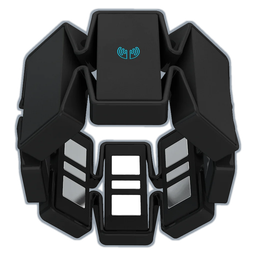

# Myo Presenter

Turns a Thalmic Labs Myo armband into a PowerPoint presenter and laser pointer on Windows 10/11.

- **Single ~230 KB exe**: C# on .NET Framework 4.8, which ships with Windows, so there's nothing to install and no admin needed.
- **Connects either way**: the Myo's blue USB dongle (a plain COM port to Windows) if it's plugged in, otherwise the PC's built-in Bluetooth. Force one with `--dongle` or `--ble`.
- **Tray app**: click the icon for gesture tips; right-click for status, the log folder, and Exit.

| Gesture | Action |
|---|---|
| Double tap | Arm / disarm |
| Wave out | Next slide |
| Wave in | Previous slide |
| Fingers spread | Laser pointer on/off (rotate your forearm to move it) |
| Fist | Black screen |

First time on: wave out once to sync the band.

Log: `%LOCALAPPDATA%\MyoPresenter\log.txt`

Download `MyoPresenter.exe` from the [latest release](../../releases/latest). If SmartScreen complains, go to Properties and tick **Unblock**.

`prototype/` holds the original Python version.

## Credits
- [pyomyo](https://github.com/PerlinWarp/pyomyo) and [myo-raw](https://github.com/dzhu/myo-raw) (MIT): BLED112 dongle protocol logic.
- [Thalmic Labs myo-bluetooth](https://github.com/thalmiclabs/myo-bluetooth) (Apache-2.0): Myo Bluetooth protocol definitions.

## License
MIT. See [LICENSE](LICENSE).
